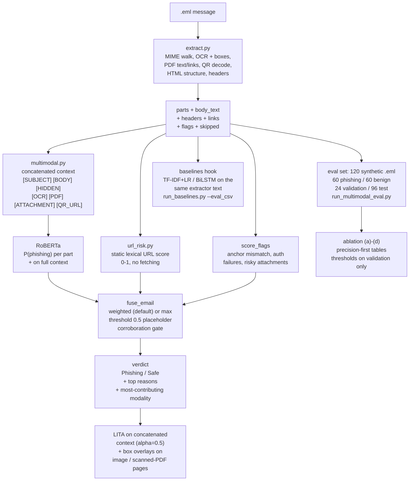

# Multimodal Extension Note (Image, QR & PDF Phishing)

## 1. Architecture

Without retraining the model or modifying `src/phishing_xai/model.py`, `src/phishing_xai/faithfulness.py`, or the pre-existing unit tests, the repository was extended to detect and explain multimodal phishing emails (`.eml` messages containing image-only bodies, inline button images, QR codes, text PDFs, and scanned image-only PDFs). The pipeline runs in three stages, extract, then URL risk, then fusion, with the eval set and the baseline ladder branching off the same extractor output.

What each piece does, in order:

1. **`src/phishing_xai/extract.py` (CLI: `python -m phishing_xai.extract <file.eml>`)**: parses `.eml` messages with Python's `stdlib email` library and walks all MIME parts. It extracts image text and word-level bounding boxes (`left`, `top`, `width`, `height`, `conf`) via `pytesseract.image_to_data`, extracts per-page PDF text and embedded or regex hyperlinks via `pdfplumber`, renders a page at 200 DPI via `PyMuPDF` (`fitz`) and runs Tesseract OCR when a PDF page has no extractable text (`kind="pdf_ocr"`), and decodes QR payloads via `pyzbar`. Section B added QR decoding and OCR on embedded images inside every PDF page, structural HTML parsing (anchor versus href mismatch, hidden text kept out of the body, base64 images, form actions, `cid:` images), headers plus the subject as a scored part, `.docx`, nested-message, `.zip`-listing and `.svg` handling, and documented safety limits (15 MB attachments, 20 PDF pages, 50 parts per mail). Tesseract is found through `$TESSERACT_CMD`, the system path, or platform defaults only; no user-specific path is hard-coded, and a missing Tesseract binary degrades to empty OCR text instead of a crash. The result carries six keys: `body_text`, `parts`, `headers`, `links`, `flags`, `skipped`.
2. **`src/phishing_xai/url_risk.py`**: a purely static lexical URL scorer (no fetching, no DNS). Each URL scores 0 to 1 from signals such as dangerous schemes, IP hosts, punycode, suspicious TLDs, shorteners, brand-keyword mismatch, high-entropy tokens and QR-only origin. Weights live in `UrlRiskConfig`; `tldextract` is an optional guarded import with a bundled-suffix fallback.
3. **`src/phishing_xai/multimodal.py` + `scripts/run_multimodal_predict.py`**: builds the concatenated context, scores every part and the full context with RoBERTa, scores the worst URL and the structural flags, and fuses them. The default `--fusion weighted` uses weights 0.45 context, 0.20 best part, 0.20 URL and 0.15 flags, and a phishing verdict needs corroboration across channels (at least two channels at 0.5 or more, or one channel plus a flag score of 0.30 or more, or a fused score of 0.75 or more). `--fusion max` keeps the old any-part rule as a recall-heavy baseline. The threshold is **0.5 as a placeholder**, to be tuned on validation only, maximising phishing-class precision subject to a recall floor. With `--explain`, LITA runs on the concatenated context (`alpha=0.5`, magnitude-preserving) and the top 5 words are printed; `draw_lita_boxes_on_image` in `src/phishing_xai/explain.py` draws red rectangles (`outline="red"`, `width=3`) around matching OCR boxes, and new helpers overlay LITA boxes on scanned-PDF pages and QR images.
4. **`scripts/run_multimodal_faithfulness.py`**: reuses `phishing_xai.faithfulness` (`evaluate_faithfulness_single_method`, `predict_probability`) unchanged to measure Comprehensiveness and Sufficiency at $k=5$ on the extracted text of the samples, now also reporting a random baseline (dropping or keeping 5 random words, 5 seeds) per sample so LITA can be compared against chance, and recording a `no_text_parts` row instead of crashing on an empty extraction.
5. **`scripts/make_multimodal_samples.py` & `tests/test_extract.py`**: generates 6 deterministic `.eml` samples in `samples/multimodal/` and verifies MIME parsing, OCR keywords, bounding boxes, PDF text and links, scanned-PDF OCR fallback, QR decoding, and bounding-box visualisation.
6. **`scripts/make_multimodal_eval_set.py` & `scripts/run_multimodal_eval.py`**: generates the 120-email synthetic eval set in `data/multimodal_eval/` (seed 42, 60 phishing / 60 benign, 24 validation / 96 test) and evaluates ablations (a) text-body only, (b) text plus OCR, (c) text plus OCR plus QR plus PDF, (d) full fusion weighted and max, with thresholds fitted on validation only and precision reported first. Cheap baselines (TF-IDF logistic regression, BiLSTM) can be fitted on the real-data train split and evaluated on the same extractor output through the Section H hook.

---

## 2. Six-Sample Results Table (untrained fallback — pipeline demonstration only)

> **Checkpoint Status**: `results/best_model.pt` is not present locally (full fine-tuning is configured for Kaggle GPU in `notebooks/kaggle_run.ipynb`). Per project rules, no local retraining was performed. Default invocation of `run_multimodal_predict.py` stops and reports `results/best_model.pt` as missing; the table below records the pipeline output with `--allow_pretrained_fallback` (untrained base `roberta-base`, which scores every part at chance, about 0.43 to 0.44). **These numbers demonstrate that extraction, scoring, LITA and faithfulness run end to end. They are not detection evidence and must never be quoted as phishing-detection results.** Every output JSON from such a run carries `"untrained_fallback": true` and the run prints a loud UNTRAINED MODEL warning.

| Sample (`.eml`) | Modality / Parts Extracted | Winning Part (Max Rule) | Extracted Text / Payload (Winning Part) | Top-5 LITA Words ($\alpha=0.5$) | Comp ($k=5$) | Suff ($k=5$) |
|---|---|---|---|---|---|---|
| `sample1_image_only_phish.eml` | `body_text` (empty), `image:account_notice.png` | `image:account_notice.png` | `"Your account will be closed. Verify now at http://secure-login-example.com"` | `at`, `account`, `Your`, `http://secure-login-example.com`, `be` | `+0.0032` | `-0.0013` |
| `sample2_text_with_button.eml` | `body_text`, `image:verify_button.png` | `image:verify_button.png` | `"Verify Account"` | `Account`, `Verify` | `-0.0041` | `+0.0000` |
| `sample3_qr_phish.eml` | `body_text`, `image:auth_qr.png`, `qr:auth_qr.png` | `qr:auth_qr.png` | `"http://secure-login-example.com/qr-verify"` | `http://secure-login-example.com/qr-verify` | `-0.0017` | `+0.0000` |
| `sample4_text_pdf_invoice.eml` | `body_text`, `pdf_text:invoice.pdf#p1` | `pdf_text:invoice.pdf#p1` | `"INVOICE #INV-90821 Payment due. Click https://billing-example.com/pay ..."` | `account`, `your`, `.`, `Click` | `-0.0005` | `-0.0027` |
| `sample5_scanned_pdf.eml` | `body_text`, `pdf_ocr:scanned_notice.pdf#p1` | `pdf_ocr:scanned_notice.pdf#p1` | `"URGENT WIRE TRANSFER REQUIRED Your account will be suspended ..."` | `confirmed`, `account`, `WIRE`, `Your`, `.` | `+0.0015` | `-0.0004` |
| `sample6_clean_benign.eml` | `body_text`, `image:agenda_banner.png`, `pdf_text:roadmap_notes.pdf#p1` | `pdf_text:roadmap_notes.pdf#p1` | `"Quarterly Engineering Roadmap Notes All sprint milestones are on track ..."` | `Quarterly`, `next`, `the`, `release`, `sprint` | `+0.0003` | `-0.0025` |

The faithfulness numbers above are near zero, and the random baseline added in Section E lands on the same values (for example sample 1 comprehensiveness about -0.0031 for both LITA and random). That is the expected artefact of an untrained model scoring everything at chance, not a finding about LITA.

---

## 3. Results From Real Runs (and what is still NOT RUN YET)

Everything in this section comes from an executed run, labelled with how it was produced. Anything not listed here has not been run.

### 3.1 Synthetic eval set, RoBERTa smoke run — UNTRAINED FALLBACK, NOT detection evidence

Source: `results/multimodal_eval/multimodal_eval.json` and `multimodal_eval.md`, produced 2026-11-19 by `scripts/run_multimodal_eval.py --allow_pretrained_fallback --output_dir results/multimodal_eval` on the 120 synthetic emails. The fine-tuned checkpoint was missing, so every RoBERTa score comes from untrained base `roberta-base` at chance level. The headline below is a pipeline check, not a detection result.

Best precision at recall floor 0.80: (d) full fusion, weighted, precision 1.00 at recall 0.75 (F1 0.86, FPR 0.00, accuracy 0.88, n=96 test emails). The weighted fusion separates the classes here through the static URL and flag channels, not through the model, because the model scores everything at chance. Ablations (a) to (c) collapse to predicting everything phishing at their fitted thresholds (precision 0.50, FPR 1.00, recall 1.00), which is what a chance-level scorer forces the validation fit to do.

| Ablation (test slice, fitted thresholds) | Precision | FPR | Recall | F1 | Accuracy | Threshold |
|---|---|---|---|---|---|---|
| (a) text-body only | 0.50 | 1.00 | 1.00 | 0.67 | 0.50 | 0.05 |
| (b) text + OCR | 0.50 | 1.00 | 1.00 | 0.67 | 0.50 | 0.05 |
| (c) text + OCR + QR + PDF | 0.50 | 1.00 | 1.00 | 0.67 | 0.50 | 0.05 |
| (d) full fusion, weighted | 1.00 | 0.00 | 0.75 | 0.86 | 0.88 | 0.34 |
| (d) full fusion, max | 0.56 | 0.52 | 0.67 | 0.61 | 0.57 | 0.44 |

Confusion matrices on the 96 test emails: weighted `[[48, 0], [12, 36]]` (no false positives, 12 missed phishing), max `[[23, 25], [16, 32]]`. The max rule is precision-poor exactly as designed against it: it flips on any single part. Per-modality recall under weighted fusion (phishing emails carrying that modality): body 36 of 48 (0.75), OCR 11 of 19 (0.58), PDF 11 of 14 (0.79), QR 12 of 14 (0.86). All 14 failures are false negatives; at the placeholder threshold 0.5 every ablation predicts nothing, because all untrained scores sit below 0.5.

### 3.2 Cheap baseline TF-IDF + logistic regression on the same synthetic set

Source: the same `results/multimodal_eval/` outputs, with the TF-IDF run merged in (run separately with `--models tfidf_lr` on the identical 120 files and the same extractor output). The model was fitted on the **real-data train split** (11,215 rows from `results/splits.json`), never on the synthetic set, and evaluated on the synthetic extractor text (subject, body, OCR, PDF and QR text combined) at threshold 0.5: **precision 0.95, recall 0.95, F1 0.95, accuracy 0.95, ROC-AUC 0.9875, FPR 0.05, confusion `[[57, 3], [3, 57]]`, n=120**. Per-modality F1: all text 0.95, body only 0.79, OCR only 0.83, PDF only 0.79, QR only 0.73. This says the synthetic templates are easy for a linear model trained on real phishing text; it says nothing about real multimodal phishing, because the eval set is synthetic and the baseline never saw a real image, PDF or QR code. The BiLSTM baseline on this set has not been run locally (CPU cost); it is a Kaggle run.

### 3.3 NOT RUN YET

- Any RoBERTa result with the trained checkpoint: threshold tuning on validation, precision, recall and FPR for weighted versus max fusion, per-modality recall with real scores, and whether the corroboration gate costs too much recall.
- The full baseline ladder on the real splits (dummy, TF-IDF logistic regression and SVM, BiLSTM, CNN, DistilBERT, RoBERTa eval-only) and the complexity-report verdict: only `--debug` smoke runs on 200/100/100 subsets exist, and those subset numbers are not tabulated anywhere as results.
- End-to-end LITA overlays for a PDF or QR winning part, and faithfulness with the trained checkpoint; the overlay helpers themselves are unit-tested, but no trained run has produced a PDF or QR winning part yet.
- Production tuning, training and faithfulness in `results/RESULTS.md`, which remain marked NOT RUN YET.
- Kaggle path auto-detection (`/kaggle/input/*/best_model.pt`, `/kaggle/working/results`): unit-covered only, never exercised on Kaggle.

---

## 4. Honest Limitations

1. **OCR errors on low-quality or adversarial images**: `pytesseract` relies on clean character segmentation and contrast. Heavy compression artifacts, skewed scans, CAPTCHA-style noise, decorative fonts, or colour-on-colour phishing banners can corrupt OCR tokens, causing downstream tokenisation and LITA word matching to miss key phishing terms. A damaged or stylised QR code yields no payload at all.
2. **Text-only model, no visual understanding**: the classifier is a text-only RoBERTa model applied to extracted OCR, PDF and QR strings. It cannot inspect visual brand logos or layout spoofing directly, so a pixel-perfect clone of a login page that OCR reads as clean text looks benign unless its words or links betray it. See the threat model in the [README](../README.md#threat-model--limitations).
3. **Additional latency from OCR, PDF rendering, and per-part XAI**: rendering scanned PDF pages via `PyMuPDF`, running Tesseract `image_to_data`, and scoring and explaining multiple MIME parts sequentially adds hundreds of milliseconds to several seconds per email compared with plain-text inference. No latency numbers have been measured yet; the baseline ladder is designed to measure them when it runs.
4. **Only 6 synthetic samples, and a synthetic 120-email eval set**: the samples in `samples/multimodal/` are clean, synthetically generated `.eml` files designed to test each modality path. The eval set in `data/multimodal_eval/` is likewise generated from a small set of templates with simulated OCR stressors. Neither measures recall or false-positive rates on wild multimodal phishing campaigns, and no real emails are in either set.
5. **No multimodal retraining and missing local checkpoint**: the model requires the Kaggle-trained `results/best_model.pt` checkpoint for calibrated phishing probabilities. Until that run exists, the fusion threshold of 0.5 is an untuned placeholder and every local score is an untrained-fallback demonstration.
6. **No URL fetching**: links are judged only by their spelling and shape. A benign-looking shortened link, a compromised legitimate domain, or a link whose danger only shows after following redirects cannot be caught by the static scorer.
7. **Synthetic-set and dataset-age limits**: the training corpus is an older Enron-style dataset, so strong results on it do not imply the same performance on modern or AI-written phishing, and the synthetic eval set has no real adversary variation. A harder out-of-distribution test is still needed.
8. **Precision-first trade-off**: weighted fusion and its corroboration gate deliberately trade recall for precision, so some real phishing will be missed. How much is unknown until a trained-checkpoint run on labelled data measures it.
