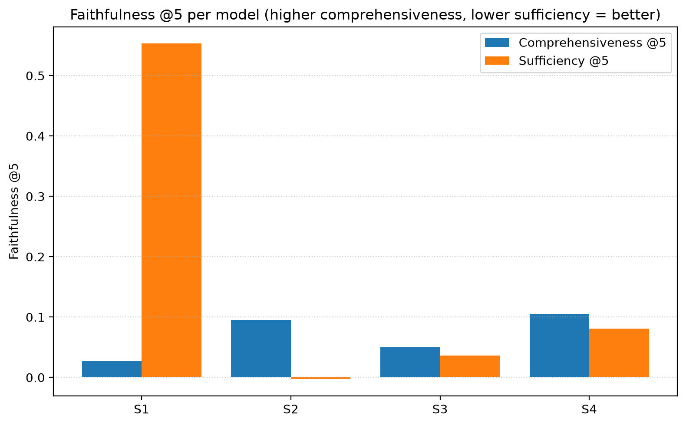

# Step 6B.5: System-Complexity Report (S1-S4 + S0)

Pure JSON analysis: this report reads only already-produced JSON files. No model was trained or loaded, no GPU was used. Any cell reading NOT RUN YET means its input file was absent when this report ran; nothing was fabricated.

**Dataset caveat:** Dataset caveat: this is an old Enron-style dataset that is highly separable, so high simple-model scores do not imply the same performance on modern, AI-written or multimodal phishing. A harder out-of-distribution test is needed before any deployment claim.

## Inputs read (all optional)

| input file | status |
|---|---|
| `baselines/baseline_results.json` (text test-set ladder (S1-S4 aggregates, McNemar, bootstrap CIs, robustness, faithfulness)) | ok |
| `metrics.json` (RoBERTa test metrics (fallback for S4 if baseline_results.json has no roberta_eval)) | ok |
| `bilstm/tuning.json` (BiLSTM tuning (validation precision/recall, best config)) | ok |
| `bilstm/faithfulness.json` (BiLSTM (6B.3) faithfulness summary) | ok |
| `bilstm/alpha_ablation.json` (BiLSTM (6B.3) alpha-ablation summary) | ok |
| `bilstm/explanations/explanations.json` (BiLSTM per-email top words (run_explain.py --model bilstm)) | ok |
| `bilstm/explanations.json` (BiLSTM per-email top words (alternate location)) | missing: bilstm/explanations.json not found |
| `explanations/explanations.json` (RoBERTa per-email top words (run_explain.py --model roberta)) | ok |
| `faithfulness.json` (Stage C RoBERTa faithfulness summary) | ok |
| `alpha_ablation.json` (Stage C RoBERTa alpha-ablation summary) | ok |
| `multimodal_eval/multimodal_eval.json` (RoBERTa (S4) multimodal 4-ablation table + held-out metrics) | ok |
| `bilstm/multimodal_eval.json` (BiLSTM (S2) multimodal 4-ablation table + held-out metrics) | ok |
| `bilstm/multimodal_eval/multimodal_eval.json` (BiLSTM (S2) multimodal 4-ablation table (alternate location)) | missing: bilstm/multimodal_eval/multimodal_eval.json not found |
| `multimodal_eval_rule_based/multimodal_eval.json` (Rule-based multimodal run (reference only, not a system)) | ok |
| `rerun_mm/verdicts.json` (Rerun multimodal floor 0.80/0.85 metrics + McNemar/CI per model (audited, n=96)) | ok |
| `rerun_latency/latency_explain_time.json` (Measured CPU/GPU latency + explanation time (RoBERTa/BiLSTM rerun, n=200/n=10)) | ok |
| `distilbert/latency/latency_explain_time.json` (DistilBERT CPU/GPU latency + LITA explanation time (seed-42 checkpoint, n=200/n=10)) | ok |
| `robustness_rerun/robustness_loaded.json` (Robustness F1, loaded-checkpoint run (RoBERTa/BiLSTM, thr 0.5, n=3,495)) | ok |
| `robustness_rerun/baseline_results.json` (Rerun refit latencies + per-seed robustness (TF-IDF+LR/SVC, CNN, seed 42)) | ok |
| `paired_mcnemar_seed42.json` (Paired seed-42 McNemar: TF-IDF+SVC vs BiLSTM / TF-IDF+LR (exact binomial)) | ok |

## System table (S1-S4 + S0)

Precision is the primary metric (user decision 2026-11-19); F1, recall, ROC-AUC and FPR are reported alongside. Mean +/- std is across seeds where the source has per-seed values; a bare number is a single run. Latency is the rerun measurement (batch 1, median of 200, CPU and GPU measured separately) where present; TF-IDF GPU latency is NOT MEASURED (no GPU implementation). Robustness F1 is clean / truncated / urls-removed / typo-synonym at threshold 0.5, n=3,495. S0 TF-IDF+SVC is the best simple baseline by precision and the comparator for the headline verdict.

| system | precision mean +/- std | recall mean +/- std | FPR | F1 mean +/- std | ROC-AUC | McNemar p vs S4 | bootstrap 95% CI (precision) | params | size MB | train time (s) | latency CPU (ms) | latency GPU (ms) | peak memory CPU/CUDA (MB) | explanation time/email (s) | faithfulness @5 comp/suff | robustness F1 (clean / trunc / urls / typo) | multimodal held-out precision / recall |
|---|---|---|---|---|---|---|---|---|---|---|---|---|---|---|---|---|---|---|
| S1 TF-IDF+LR | 0.9701 +/- 0.0006 | 0.9831 +/- 0.0037 | 0.0184 | 0.9766 +/- 0.0016 | 0.9981 | 0.3491 | [0.9607, 0.9793] | 40001 | 0.89 | 8.4 | 1.09 | NOT RUN YET | 2276.2 / 0.0 | NOT RUN YET (explanation seconds/email was never measured for this model (run_latency_explain_time.py covers RoBERTa LITA and BiLSTM LITA-IG only); NOT RUN YET) | 0.0272 / 0.5531 (coefficients) | 0.9748 / 0.9668 / 0.9730 / 0.9739 | 0.9412 / 1.0000 |
| S2 BiLSTM | 0.9719 +/- 0.0015 | 0.9428 +/- 0.0164 | 0.0166 | 0.9571 +/- 0.0077 | 0.9942 | 0.0002 | [0.9613, 0.9789] | 6236034 | 23.79 | 135.8 | 19.90 | 8.37 | 2554.1 / 166.5 | 1.87 (median, n=10, lime_ig) | 0.0950 / -0.0027 (lita_magnitude) | 0.9658 / 0.9658 / 0.9654 / 0.9637 | 1.0000 / 1.0000 |
| S3 DistilBERT | 0.9890 +/- 0.0022 | 0.9476 +/- 0.0122 | 0.0064 | 0.9678 +/- 0.0054 | 0.9983 | 0.0754 | [0.9799, 0.9930] | 66955010 | 255.45 | 388.7 | 118.62 | 9.57 | 5586.1 / 1725.2 | 15.69 (median, n=10, lita) | 0.0498 / 0.0363 (lita_magnitude) | 0.9739 / 0.9688 / 0.9739 / 0.9745 | 1.0000 / 0.9375 |
| S4 RoBERTa | 0.9690 +/- 0.0000 | 0.9932 +/- 0.0000 | 0.0193 | 0.9809 +/- 0.0000 | 0.9986 | NOT RUN YET | NOT RUN YET | 124647170 | 475.57 | NOT RUN YET | 242.50 | 15.50 | NOT RUN YET | 30.87 (median, n=10, lita) | 0.1055 / 0.0809 (lita_magnitude) | 0.9809 / 0.9773 / 0.9755 / 0.9638 | 1.0000 / 0.9792 |
| S0 TF-IDF+SVC (best simple baseline) | 0.9820 +/- 0.0007 | 0.9889 +/- 0.0016 | 0.0110 | 0.9854 +/- 0.0008 | 0.9992 | 0.2530 | [0.9746, 0.9889] | 3972261 | 54.81 | 109.4 | 8.47 | NOT RUN YET | 4652.7 / 0.0 | NOT RUN YET (explanation seconds/email was never measured for this model (run_latency_explain_time.py covers RoBERTa LITA and BiLSTM LITA-IG only); NOT RUN YET) | NOT RUN YET | 0.9845 / 0.9726 / 0.9849 / 0.9835 | 0.9556 / 0.8958 |

## Verdict

Verdict (precision-first, vs best simple baseline TF-IDF+SVC): RoBERTa is below the best simple baseline by 1.30 precision points on the text test set (RoBERTa 0.9690 vs SVC 0.9820; McNemar p = 0.2530) at 28.6x CPU latency and 31.4x parameters. GPU latency multiple: NOT MEASURED (TF-IDF has no GPU implementation). Its complexity is NOT justified by a precision gain on this dataset. BiLSTM is also below SVC, by 1.00 precision points (0.9719 vs 0.9820; paired seed-42 McNemar p = 3.64e-08 — SVC is significantly better than BiLSTM on test errors), at 2.35x CPU latency and 1.57x parameters. In plain terms: on this old, highly separable Enron-style test set the cheapest model wins on precision, and neither neural model earns its cost in accuracy — RoBERTa does buy the highest recall (0.9932 vs SVC 0.9889) and the LITA explanations plus image/PDF/QR handling the baselines do not provide, while BiLSTM buys the fastest explanations (1.87 s/email vs RoBERTa 30.87 s/email). Whether that is worth it depends on the deployment budget, not on accuracy.

### Verdict numbers (RoBERTa / BiLSTM vs TF-IDF+SVC, text test set n=3,495)

| comparison | precision | recall | F1 | ROC-AUC | CPU latency multiple | GPU latency multiple | explanation median (s/email) |
|---|---|---|---|---|---|---|---|
| RoBERTa vs SVC | 0.9690 vs 0.9820 | 0.9932 vs 0.9889 | 0.9809 vs 0.9854 | 0.9986 vs 0.9992 | 28.63x | NOT RUN YET (TF-IDF has no GPU implementation) | 30.87 vs NOT RUN YET |
| BiLSTM vs SVC | 0.9719 vs 0.9820 | 0.9428 vs 0.9889 | 0.9571 vs 0.9854 | 0.9942 vs 0.9992 | 2.35x | NOT RUN YET (TF-IDF has no GPU implementation) | 1.87 vs NOT RUN YET |

CPU latency multiples are explicit (RoBERTa CPU 242.50 ms / SVC CPU 8.47 ms; BiLSTM CPU 19.90 ms / SVC CPU 8.47 ms — rerun medians of 200, batch 1). GPU multiples are NOT MEASURED because TF-IDF GPU latency was never measured. Robustness F1 (clean / trunc / urls / typo): RoBERTa 0.9809 / 0.9773 / 0.9755 / 0.9638, SVC 0.9845 / 0.9726 / 0.9849 / 0.9835; BiLSTM 0.9658 / 0.9658 / 0.9654 / 0.9637, SVC 0.9845 / 0.9726 / 0.9849 / 0.9835 — see the system table for the numbers. Multimodal (floor 0.85, n=96): RoBERTa 1.0000/0.9792, SVC 0.9556/0.8958 (McNemar vs RoBERTa p=0.0703), BiLSTM 1.0000/1.0000 (p=1.0).

### Earlier verdict (vs TF-IDF+LR, kept for traceability)

Verdict (precision-first): Transformer is below the best simple baseline by 0.11 precision points on the text test set (RoBERTa 0.9690 vs tfidf_lr 0.9701; McNemar p = 0.3491) at 222.6x latency and 3116.1x parameters. Its complexity is NOT justified by a precision gain on this dataset; value lies in the XAI/multimodal layer.

The LR-based verdict is superseded: TF-IDF+SVC (precision 0.9820) is the best simple baseline, not TF-IDF+LR (0.9701). The old line claiming a "significant 5.88-point gain (p=0.625)" was withdrawn 2026-11-19 and must not be reused.

**Recommended deployment model:** distilbert (S3, precision 0.9890, recall 0.9476; recall floor 0.85 met)

## Top-word agreement (LSTM vs RoBERTa)

Matched emails: 10. Mean Jaccard (top-5 word sets): 0.1004. Mean Spearman rho (top-5 ranks, absent word = rank 6): -0.4974 (n=10). Top 5 per email is by |LITA score| from word_level_attributions (lime_top_words fallback) in the two explanations.json files. RoBERTa file declares model='roberta'; BiLSTM file declares model='bilstm'.

The two models largely do NOT point at the same words: their top-5 explanations overlap only slightly and their rankings run in opposite directions on average. An earlier version of this report showed Jaccard/Spearman 1.0000 for this section — that was a cross-loading error (the RoBERTa file had been overwritten by the BiLSTM run, so the file was compared with itself). The genuine RoBERTa explanations file was recovered from results dataset v7 (stage_c); the numbers above are computed from it, and the generator now refuses cross-loaded files instead of reporting a self-comparison.

## Sampling note

Sampling comparability (checked against the scripts, 2026-11-19). run_faithfulness.py and run_ablation.py draw their emails with test_df.sample(n=sample_size, random_state=seed) from the same test split, so the SAME --seed and SAME --sample_size give the SAME emails for RoBERTa and for BiLSTM (--model bilstm) — provided the splits are identical. The sampled email ids are verifiable post-hoc in faithfulness_records.jsonl (one record per email, with email_id); faithfulness.json / alpha_ablation.json themselves store only the summary plus metadata seed/sample_count, no per-email words. run_explain.py is DIFFERENT: it takes test_df.head(num_samples) — the first N test rows, seed-independent — so its emails are NOT the faithfulness sample. Agreement between models is still valid from explanations.json because both models explain the same head(N) emails, but only when both runs use the same --num_samples AND different --output_dir values (the default results/explanations/explanations.json would be overwritten by the second run). Per-email top words ARE stored by run_explain.py (word_level_attributions with lita_score per word, plus lime_top_words top 15, keyed by id) — so no code change is needed for agreement; the discipline is CLI-level (same --num_samples, separate --output_dir). If a future explain run stops storing per-email words, agreement falls back to NOT RUN YET.

## Out-of-distribution check

OOD results are summarised from already-produced `<set>_<model>_metrics.json` files (threshold 0.5); nothing was re-evaluated here. Full analysis: `experiments/modern_phishing_ood/reports/final_comparative_report.md`. PhishNChips v5.2 is modern URL-grounded synthetic-stimuli OOD, NOT real inbox mail.

### Primary OOD — PhishNChips v5.2 (n=2,000)

| model | accuracy | precision | recall | F1 | ROC-AUC | PR-AUC | FPR |
|---|---|---|---|---|---|---|---|
| roberta | 0.5130 | 0.9333 | 0.0280 | 0.0544 | 0.7787 | 0.7947 | 0.0020 |
| bilstm | 0.5230 | 0.8594 | 0.0550 | 0.1034 | 0.6801 | 0.6768 | 0.0090 |
| tfidf_svm | 0.5360 | 0.9000 | 0.0810 | 0.1486 | 0.6604 | 0.6724 | 0.0090 |
| tfidf_lr | 0.5905 | 0.9788 | 0.1850 | 0.3112 | 0.7528 | 0.7771 | 0.0040 |
| distilbert | 0.5070 | 1.0000 | 0.0140 | 0.0276 | 0.8222 | 0.8250 | 0.0000 |

### Synthetic track — Frontiers LLM-generated phishing + PhishNChips legit (n=5986)

| model | accuracy | precision | recall | F1 | ROC-AUC | PR-AUC | FPR |
|---|---|---|---|---|---|---|---|
| roberta | 0.9492 | 0.9996 | 0.9394 | 0.9686 | 0.9994 | 0.9998 | 0.0020 |
| bilstm | 0.5643 | 0.9962 | 0.4787 | 0.6467 | 0.9542 | 0.9883 | 0.0090 |
| tfidf_svm | 0.6816 | 0.9971 | 0.6195 | 0.7642 | 0.9379 | 0.9872 | 0.0090 |
| tfidf_lr | 0.8483 | 0.9990 | 0.8187 | 0.8999 | 0.9748 | 0.9951 | 0.0040 |
| distilbert | 0.8059 | 1.0000 | 0.7669 | 0.8681 | 0.9988 | 0.9998 | 0.0000 |

### Synthetic track — Frontiers human-authored phishing (OLD corpora, not modern) + PhishNChips legit (n=6000)

| model | accuracy | precision | recall | F1 | ROC-AUC | PR-AUC | FPR |
|---|---|---|---|---|---|---|---|
| roberta | 0.8665 | 0.9995 | 0.8402 | 0.9130 | 0.9902 | 0.9981 | 0.0020 |
| bilstm | 0.7673 | 0.9975 | 0.7226 | 0.8381 | 0.9501 | 0.9901 | 0.0090 |
| tfidf_svm | 0.8497 | 0.9978 | 0.8214 | 0.9011 | 0.9699 | 0.9940 | 0.0090 |
| tfidf_lr | 0.8660 | 0.9990 | 0.8400 | 0.9126 | 0.9823 | 0.9965 | 0.0040 |
| distilbert | 0.8810 | 1.0000 | 0.8572 | 0.9231 | 0.9971 | 0.9994 | 0.0000 |

### Synthetic track — Adversarial BEC + PhishNChips legit (n=5181)

| model | accuracy | precision | recall | F1 | ROC-AUC | PR-AUC | FPR |
|---|---|---|---|---|---|---|---|
| roberta | 0.4970 | 0.9987 | 0.3772 | 0.5476 | 0.9513 | 0.9880 | 0.0020 |
| bilstm | 0.3609 | 0.9899 | 0.2102 | 0.3468 | 0.8320 | 0.9518 | 0.0090 |
| tfidf_svm | 0.5045 | 0.9945 | 0.3882 | 0.5584 | 0.9001 | 0.9738 | 0.0090 |
| tfidf_lr | 0.4476 | 0.9970 | 0.3164 | 0.4804 | 0.9067 | 0.9747 | 0.0040 |
| distilbert | 0.3142 | 1.0000 | 0.1502 | 0.2612 | 0.9560 | 0.9891 | 0.0000 |

### Synthetic track — BEC poisoned (homoglyph/invisible-Unicode) + PhishNChips legit (n=5181)

| model | accuracy | precision | recall | F1 | ROC-AUC | PR-AUC | FPR |
|---|---|---|---|---|---|---|---|
| roberta | 0.5399 | 0.9989 | 0.4303 | 0.6015 | 0.9565 | 0.9894 | 0.0020 |
| bilstm | 0.3723 | 0.9905 | 0.2243 | 0.3658 | 0.8436 | 0.9553 | 0.0090 |
| tfidf_svm | 0.4868 | 0.9942 | 0.3662 | 0.5352 | 0.8939 | 0.9719 | 0.0090 |
| tfidf_lr | 0.4347 | 0.9968 | 0.3004 | 0.4617 | 0.8975 | 0.9720 | 0.0040 |
| distilbert | 0.3822 | 1.0000 | 0.2344 | 0.3798 | 0.9614 | 0.9906 | 0.0000 |

### Secondary — PhishFuzzer Manual-300 binary slice (n=205)

| model | accuracy | precision | recall | F1 | ROC-AUC | PR-AUC | FPR |
|---|---|---|---|---|---|---|---|
| roberta | 0.5122 | 0.5109 | 0.6796 | 0.5833 | 0.5711 | 0.6145 | 0.6569 |
| bilstm | 0.5268 | 0.5312 | 0.4951 | 0.5126 | 0.5149 | 0.5770 | 0.4412 |
| tfidf_svm | 0.5317 | 0.5263 | 0.6796 | 0.5932 | 0.5819 | 0.6379 | 0.6176 |
| tfidf_lr | 0.5317 | 0.5238 | 0.7476 | 0.6160 | 0.5603 | 0.5872 | 0.6863 |
| distilbert | 0.5317 | 0.5299 | 0.6019 | 0.5636 | 0.5478 | 0.5897 | 0.5392 |

## Plots

### Plot 1: precision vs latency per system

### Plot 2: faithfulness @5 per model

### Plot 3: multimodal ablation bars per backbone

### Plot 4: LSTM vs RoBERTa top-word agreement

