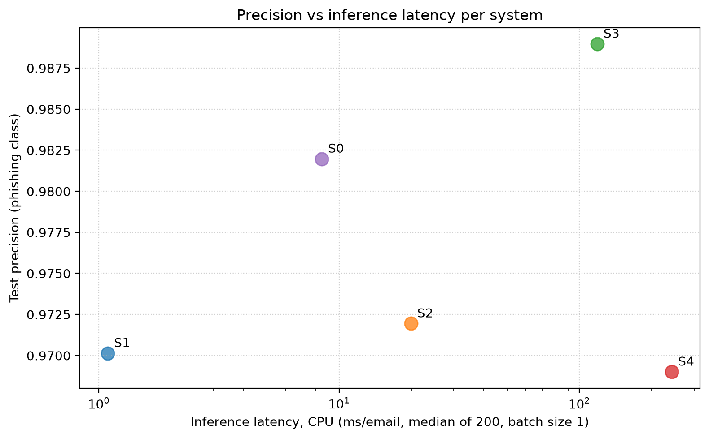

# Step 6B.5: System-Complexity Report (S1-S4)

Pure JSON analysis: this report reads only already-produced JSON files. No model was trained or loaded, no GPU was used. Any cell reading NOT RUN YET means its input file was absent when this report ran; nothing was fabricated.

**Dataset caveat:** Dataset caveat: this is an old Enron-style dataset that is highly separable, so high simple-model scores do not imply the same performance on modern, AI-written or multimodal phishing. A harder out-of-distribution test is needed before any deployment claim.

## Inputs read (all optional)

| input file | status |
|---|---|
| `baselines/baseline_results.json` (text test-set ladder (S1-S4 aggregates, McNemar, bootstrap CIs, robustness, faithfulness)) | ok |
| `metrics.json` (RoBERTa test metrics (fallback for S4 if baseline_results.json has no roberta_eval)) | ok |
| `bilstm/tuning.json` (BiLSTM tuning (validation precision/recall, best config)) | ok |
| `bilstm/faithfulness.json` (BiLSTM (6B.3) faithfulness summary) | ok |
| `bilstm/alpha_ablation.json` (BiLSTM (6B.3) alpha-ablation summary) | ok |
| `bilstm/explanations/explanations.json` (BiLSTM per-email top words (run_explain.py --model bilstm)) | ok |
| `bilstm/explanations.json` (BiLSTM per-email top words (alternate location)) | missing: /home/hatch/workspace/kaggle_downloads/regen/bilstm/explanations.json not found |
| `explanations/explanations.json` (RoBERTa per-email top words (run_explain.py --model roberta)) | ok |
| `faithfulness.json` (Stage C RoBERTa faithfulness summary) | ok |
| `alpha_ablation.json` (Stage C RoBERTa alpha-ablation summary) | ok |
| `multimodal_eval/multimodal_eval.json` (RoBERTa (S4) multimodal 4-ablation table + held-out metrics) | ok |
| `bilstm/multimodal_eval.json` (BiLSTM (S2) multimodal 4-ablation table + held-out metrics) | ok |
| `bilstm/multimodal_eval/multimodal_eval.json` (BiLSTM (S2) multimodal 4-ablation table (alternate location)) | missing: /home/hatch/workspace/kaggle_downloads/regen/bilstm/multimodal_eval/multimodal_eval.json not found |
| `multimodal_eval_rule_based/multimodal_eval.json` (Rule-based multimodal run (reference only, not a system)) | ok |

## System table (S1-S4)

Precision is the primary metric (user decision 2026-11-19); F1, recall, ROC-AUC and FPR are reported alongside. Mean +/- std is across seeds where the source has per-seed values; a bare number is a single run.

| system | precision mean +/- std | recall mean +/- std | FPR | F1 mean +/- std | ROC-AUC | McNemar p vs S4 | bootstrap 95% CI (precision) | params | size MB | train time (s) | latency CPU (ms) | latency GPU (ms) | peak memory CPU/CUDA (MB) | explanation time/email (s) | faithfulness @5 comp/suff | robustness F1 (trunc / urls / typo) | multimodal held-out precision / recall |
|---|---|---|---|---|---|---|---|---|---|---|---|---|---|---|---|---|---|---|
| S1 TF-IDF+LR | 0.9701 +/- 0.0006 | 0.9831 +/- 0.0037 | 0.0184 | 0.9766 +/- 0.0016 | 0.9981 | 0.3491 | [0.9607, 0.9793] | 40001 | 0.89 | 8.4 | 1.08 | NOT RUN YET | 2276.2 / 0.0 | NOT RUN YET (no script records explanation seconds/email (run_explain.py / run_faithfulness.py record no timing); NOT RUN YET) | 0.0272 / 0.5531 (coefficients) | NOT RUN YET | 0.9412 / 1.0000 |
| S2 BiLSTM | 0.9719 +/- 0.0015 | 0.9428 +/- 0.0164 | 0.0166 | 0.9571 +/- 0.0077 | 0.9942 | 0.0002 | [0.9613, 0.9789] | 6236034 | 23.79 | 135.8 | 8.31 | 8.23 | 2554.1 / 166.5 | NOT RUN YET (no script records explanation seconds/email (run_explain.py / run_faithfulness.py record no timing); NOT RUN YET) | 0.0950 / -0.0027 (lita_magnitude) | NOT RUN YET | 1.0000 / 1.0000 |
| S3 DistilBERT | 0.9731 +/- 0.0000 | 0.9849 +/- 0.0000 | 0.0166 | 0.9789 +/- 0.0000 | 0.9983 | 0.6025 | [0.9635, 0.9820] | 66955010 | 255.45 | 518.5 | NOT RUN YET | NOT RUN YET | NOT RUN YET | NOT RUN YET (no script records explanation seconds/email (run_explain.py / run_faithfulness.py record no timing); NOT RUN YET) | NOT RUN YET | NOT RUN YET | NOT RUN YET (DistilBERT multimodal run not present (skipped, like S3 on the text set)) |
| S4 RoBERTa | 0.9690 +/- 0.0000 | 0.9932 +/- 0.0000 | 0.0193 | 0.9809 +/- 0.0000 | 0.9986 | NOT RUN YET | NOT RUN YET | 124647170 | 475.57 | NOT RUN YET | NOT RUN YET | NOT RUN YET | NOT RUN YET | NOT RUN YET (no script records explanation seconds/email (run_explain.py / run_faithfulness.py record no timing); NOT RUN YET) | 0.1055 / 0.0809 (lita_magnitude) | NOT RUN YET | 1.0000 / 0.9792 |

## Verdict

Verdict (precision-first): Transformer is below the best simple baseline by 0.11 precision points on the text test set (RoBERTa 0.9690 vs tfidf_lr 0.9701; McNemar p = 0.3491) at 223.7x latency and 3116.1x parameters. Its complexity is NOT justified by a precision gain on this dataset; value lies in the XAI/multimodal layer.

**Recommended deployment model:** distilbert (S3, precision 0.9731, recall 0.9849; recall floor 0.85 met)

## Top-word agreement (LSTM vs RoBERTa)

Matched emails: 10. Mean Jaccard (top-5 word sets): 1.0000. Mean Spearman rho (top-5 ranks, absent word = rank 6): 1.0000 (n=10). Top 5 per email is by |LITA score| from word_level_attributions (lime_top_words fallback) in the two explanations.json files.

## Sampling note

Sampling comparability (checked against the scripts, 2026-11-19). run_faithfulness.py and run_ablation.py draw their emails with test_df.sample(n=sample_size, random_state=seed) from the same test split, so the SAME --seed and SAME --sample_size give the SAME emails for RoBERTa and for BiLSTM (--model bilstm) — provided the splits are identical. The sampled email ids are verifiable post-hoc in faithfulness_records.jsonl (one record per email, with email_id); faithfulness.json / alpha_ablation.json themselves store only the summary plus metadata seed/sample_count, no per-email words. run_explain.py is DIFFERENT: it takes test_df.head(num_samples) — the first N test rows, seed-independent — so its emails are NOT the faithfulness sample. Agreement between models is still valid from explanations.json because both models explain the same head(N) emails, but only when both runs use the same --num_samples AND different --output_dir values (the default results/explanations/explanations.json would be overwritten by the second run). Per-email top words ARE stored by run_explain.py (word_level_attributions with lita_score per word, plus lime_top_words top 15, keyed by id) — so no code change is needed for agreement; the discipline is CLI-level (same --num_samples, separate --output_dir). If a future explain run stops storing per-email words, agreement falls back to NOT RUN YET.

## Out-of-distribution check

OOD test: NOT RUN YET (no --ood_csv supplied and no OOD result in the inputs).

## Plots

### Plot 1: precision vs latency per system

### Plot 2: faithfulness @5 per model

### Plot 3: multimodal ablation bars per backbone

### Plot 4: LSTM vs RoBERTa top-word agreement

